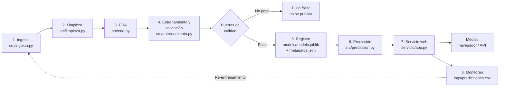

# Servicio de predicción de estado del paciente (ML + Flask + Docker)

## 1. Finalidad

Este proyecto implementa, de principio a fin, un modelo de Machine Learning que ayuda a un **médico** a estimar el estado de un paciente a partir de tres datos clínicos:

| Estado | Significado clínico |
|---|---|
| **NO ENFERMO** | Sin fiebre y con dolor mínimo |
| **ENFERMEDAD LEVE** | Síntomas moderados en un cuadro reciente |
| **ENFERMEDAD AGUDA** | Fiebre alta o dolor intenso en un cuadro reciente |
| **ENFERMEDAD CRÓNICA** | Síntomas que persisten por más de 30 días |
| **ENFERMEDAD TERMINAL** | Más de 180 días con síntomas y dolor severo (≥ 8) |

El proyecto sigue el flujo de un proyecto de ML real: **datos → limpieza → EDA → entrenamiento → validación → registro → despliegue → predicción → monitoreo**. Todo queda empaquetado en una imagen **Docker**: al construirla se entrena el modelo, y al correrla el médico lo consulta desde el navegador o por API, sin instalar Python.

> ⚠️ Es una herramienta de apoyo. La decisión clínica final siempre es del médico.

> ℹ️ **Sobre los datos:** como los datos clínicos reales son sensibles y no están disponibles, la etapa de ingesta **simula** una fuente de historias clínicas. Genera pacientes sintéticos con un diagnóstico asignado por reglas clínicas, e introduce errores típicos (faltantes, duplicados, unidades equivocadas, valores imposibles). En un proyecto real solo cambiaría `src/ingesta.py`, para leer de la base de datos del hospital.

---

## 2. Arquitectura del pipeline



| Etapa | Archivo | Qué hace | Salida |
|---|---|---|---|
| 1. Ingesta | `src/ingesta.py` | Obtiene (simula) los registros clínicos | `data/raw/pacientes_raw.csv` |
| 2. Limpieza | `src/limpieza.py` | Quita duplicados y registros sin diagnóstico, corrige Fahrenheit, descarta valores imposibles | `data/processed/pacientes_limpios.csv`, `reports/limpieza_reporte.json` |
| 3. EDA | `src/eda.py` | Estadísticas, desbalance de clases, correlaciones, gráficas | `reports/eda_resumen.txt`, `reports/figuras/*.png` |
| 4. Entrenamiento | `src/entrenamiento.py` | Compara 3 modelos con validación cruzada, evalúa el mejor en test y aplica las puertas de calidad | `reports/metricas.json` |
| 5. Registro | `src/entrenamiento.py` | Guarda el modelo y sus metadatos (versión, métricas, hash de datos) | `models/modelo.joblib`, `models/metadatos.json` |
| 6. Predicción | `src/prediccion.py` | Valida la entrada y predice el estado con el modelo registrado | Estado + probabilidades |
| 7. Servicio | `servicio/app.py` | Expone el modelo en una página web y una API REST | `http://localhost:5000` |
| 8. Monitoreo | `src/prediccion.py` | Registra cada consulta para detectar drift y re-entrenar | `logs/predicciones.csv` |
| 9. Estadísticas | `src/estadisticas.py` | Lee el log y arma el reporte para los médicos | `/estadisticas`, `/reporte` |

`src/pipeline.py` orquesta las etapas 1 a 5 con un solo comando: `python -m src.pipeline`.

En [`PROCESO_ML.md`](PROCESO_ML.md) se explica cada etapa en detalle, con las decisiones tomadas.

---

## 3. Estructura del proyecto

```
parte2_docker/
├── src/                              # Código del pipeline de ML
│   ├── config.py                     # Rutas, parámetros, variables, umbrales de calidad
│   ├── ingesta.py                    # 1. Ingesta (simulación de la fuente clínica)
│   ├── limpieza.py                   # 2. Validación y limpieza
│   ├── eda.py                        # 3. Análisis exploratorio
│   ├── entrenamiento.py              # 4-5. Entrenamiento, validación, registro
│   ├── prediccion.py                 # 6. Predicción + log de monitoreo
│   ├── estadisticas.py               # 9. Reporte de las predicciones realizadas
│   └── pipeline.py                   # Orquestador de las etapas 1 a 5
├── servicio/                         # Despliegue
│   ├── app.py                        # 7. API Flask + página web
│   └── templates/
│       ├── index.html                # Formulario para el médico
│       └── reporte.html              # Reporte de estadísticas
├── requirements.txt                  # Dependencias del servicio (producción)
├── requirements-entrenamiento.txt    # + dependencias del entrenamiento (matplotlib)
├── Dockerfile                        # Multi-etapa: entrenamiento -> servicio
├── docker-compose.yml                # Construir y correr con un solo comando
├── .dockerignore
├── README.md                         # Este archivo
├── PROCESO_ML.md                     # Explicación detallada de cada etapa
└── PRUEBAS.md                        # Cómo verificar la solución y resultados esperados

# Carpetas que se GENERAN al ejecutar el pipeline (no van en el repositorio):
├── data/raw/ y data/processed/       # Datos crudos y limpios
├── models/                           # Modelo entrenado + metadatos
├── reports/                          # EDA, figuras, métricas
└── logs/                             # Predicciones realizadas (monitoreo)
```

---

## 4. Variables de entrada del modelo

| Campo | Tipo | Unidad | Rango válido | Descripción |
|---|---|---|---|---|
| `temperatura` | decimal | °C | 34.0 – 43.0 | Temperatura corporal |
| `dias_sintomas` | entero | días | 0 – 3650 | Días que el paciente lleva con síntomas |
| `intensidad_dolor` | entero | escala | 0 – 10 | Dolor reportado (0 = nada, 10 = máximo) |

Si un valor no es numérico o está fuera de rango, el servicio responde con un **mensaje de error** en lugar de una predicción.

---

## 5. Requisitos previos

- **Docker** instalado (Docker Desktop en Windows/macOS o Docker Engine en Linux). Para comprobarlo: `docker --version`
- Puerto **5000** libre.
- Conexión a internet la primera vez (para descargar la imagen base de Python y las librerías).

---

## 6. Cómo construir la imagen

Ubicarse en la carpeta `parte2_docker` (donde está el `Dockerfile`):

```bash
cd parte2_docker
```

```bash
docker build -t modelo-medico .
```

El `Dockerfile` es **multi-etapa**:

**Etapa 1, `entrenamiento`:**
1. Parte de `python:3.12-slim` e instala las dependencias de entrenamiento.
2. Copia el código de `src/`.
3. Ejecuta `python -m src.pipeline`: ingesta → limpieza → EDA → entrenamiento → puertas de calidad → registro del modelo.
4. Si el modelo **no supera las puertas de calidad**, la construcción **falla** y no se publica un modelo malo.

**Etapa 2, `servicio`** (imagen final):
1. Parte de una imagen `python:3.12-slim` limpia e instala solo las dependencias de producción.
2. Copia el código de predicción y del servicio web.
3. Copia desde la etapa 1 **solo los artefactos**: `models/` (modelo + metadatos) y `reports/`.
4. Crea un usuario sin privilegios, expone el puerto 5000, define un `HEALTHCHECK` y arranca `gunicorn`.

Durante la construcción se ven en consola los mensajes del pipeline: registros limpiados, F1 de cada modelo en validación cruzada, modelo elegido, métricas en test y versión registrada.

```bash
docker images modelo-medico
```

---

## 7. Cómo correr la solución

### Opción A: `docker run`

```bash
docker run -d -p 5000:5000 --name modelo-medico modelo-medico
```

- `-d`: en segundo plano · `-p 5000:5000`: puerto del equipo → puerto del contenedor · `--name`: nombre del contenedor.

```bash
docker ps
```

El estado debe mostrar `(healthy)` tras unos segundos.

### Opción B: Docker Compose (construye y corre en un paso)

```bash
docker compose up -d --build
```

Compose además guarda el log de predicciones en un volumen (`logs_predicciones`), así que no se pierde si se borra el contenedor.

> Si el puerto 5000 está ocupado: `-p 8080:5000` y entrar a `http://localhost:8080`.

---

## 8. Cómo obtener respuestas del modelo

### 8.1 Página web

1. Abrir **http://localhost:5000**
2. Ingresar temperatura, días con síntomas e intensidad del dolor.
3. Pulsar **Predecir**: aparece el estado (con color), la probabilidad de cada estado y la versión del modelo.

### 8.2 API: `POST /predecir`

**curl** (Linux, macOS, Git Bash):

```bash
curl -X POST http://localhost:5000/predecir -H "Content-Type: application/json" -d "{\"temperatura\": 39.5, \"dias_sintomas\": 2, \"intensidad_dolor\": 8}"
```

**PowerShell** (Windows):

```powershell
Invoke-RestMethod -Uri http://localhost:5000/predecir -Method Post -ContentType "application/json" -Body '{"temperatura": 39.5, "dias_sintomas": 2, "intensidad_dolor": 8}'
```

Respuesta (las probabilidades exactas dependen del entrenamiento):

```json
{
  "estado": "ENFERMEDAD AGUDA",
  "probabilidades": {
    "ENFERMEDAD AGUDA": 0.97,
    "ENFERMEDAD CRÓNICA": 0.0,
    "ENFERMEDAD TERMINAL": 0.0,
    "ENFERMEDAD LEVE": 0.02,
    "NO ENFERMO": 0.01
  },
  "entrada": {"temperatura": 39.5, "dias_sintomas": 2, "intensidad_dolor": 8},
  "version_modelo": "20261105120000"
}
```

Error de validación (código **400**):

```json
{"error": "El valor de 'temperatura' (50.0) está fuera del rango permitido [34.0, 43.0]."}
```

También funciona con **Postman**: `POST http://localhost:5000/predecir`, *Body → raw → JSON*.

### 8.3 Otros puntos finales

| Ruta | Para qué |
|---|---|
| `GET /salud` | Verifica que el servicio esté activo y el modelo cargado |
| `GET /modelo/info` | Versión del modelo, algoritmo elegido, métricas, fecha y hash de los datos de entrenamiento |
| `GET /estadisticas` | Reporte de predicciones en JSON (ver 8.4) |
| `GET /reporte` | Reporte de predicciones en una página web |

```bash
curl http://localhost:5000/modelo/info
```

### 8.4 Reporte de estadísticas de las predicciones

Cada predicción (web o API) se exporta a `logs/predicciones.csv`. A partir de ese archivo el servicio arma un reporte con:

- **Número total de predicciones por cada categoría** (los 5 estados, incluidos los que tienen 0).
- **Últimas 5 predicciones** realizadas (la más reciente primero).
- **Fecha de la última predicción** (UTC).

Página web: abrir **http://localhost:5000/reporte** (también hay un enlace en el formulario).

API:

```bash
curl http://localhost:5000/estadisticas
```

```json
{
  "total_predicciones": 2,
  "total_por_categoria": {
    "NO ENFERMO": 0,
    "ENFERMEDAD LEVE": 0,
    "ENFERMEDAD AGUDA": 1,
    "ENFERMEDAD CRÓNICA": 0,
    "ENFERMEDAD TERMINAL": 1
  },
  "ultimas_predicciones": [
    {"fecha_utc": "2026-11-15T01:12:30+00:00", "temperatura": 37.0, "dias_sintomas": 365, "intensidad_dolor": 9, "estado": "ENFERMEDAD TERMINAL", "version_modelo": "20261115010607"},
    {"fecha_utc": "2026-11-15T01:12:10+00:00", "temperatura": 39.5, "dias_sintomas": 2, "intensidad_dolor": 8, "estado": "ENFERMEDAD AGUDA", "version_modelo": "20261115010607"}
  ],
  "fecha_ultima_prediccion": "2026-11-15T01:12:30+00:00"
}
```

Sin predicciones todavía, el reporte trae los valores por defecto: todos los conteos en `0`, `ultimas_predicciones` vacía y `fecha_ultima_prediccion` en `null`.

Desde la consola del contenedor:

```bash
docker exec modelo-medico python -m src.estadisticas
```

> Con Docker Compose el log vive en el volumen `logs_predicciones`, así que las estadísticas se conservan aunque se recree el contenedor.

### 8.5 Ejemplos de entrada para cada estado

| temperatura | dias_sintomas | intensidad_dolor | Resultado |
|---|---|---|---|
| 36.5 | 0 | 0 | NO ENFERMO |
| 37.8 | 3 | 4 | ENFERMEDAD LEVE |
| 39.5 | 2 | 8 | ENFERMEDAD AGUDA |
| 37.6 | 90 | 5 | ENFERMEDAD CRÓNICA |
| 37.0 | 365 | 9 | ENFERMEDAD TERMINAL |

Estos 5 casos son los **casos de referencia** (`src/config.py`). El pipeline verifica que el modelo los prediga correctamente antes de publicarlo; si no lo hace, la imagen no se construye.

---

## 9. Ver reportes del entrenamiento y el monitoreo

Resumen del EDA, métricas y metadatos del modelo dentro del contenedor:

```bash
docker exec modelo-medico cat reports/eda_resumen.txt
```

```bash
docker exec modelo-medico cat reports/metricas.json
```

Log de predicciones (monitoreo):

```bash
docker exec modelo-medico cat logs/predicciones.csv
```

Copiar los reportes (incluidas las figuras del EDA) al equipo:

```bash
docker cp modelo-medico:/proyecto/reports ./reports
```

---

## 10. Re-entrenar el modelo

Cuando llegan datos nuevos (en un caso real, casos con diagnóstico confirmado), se vuelve a ejecutar el pipeline reconstruyendo la imagen:

```bash
docker compose up -d --build
```

El nuevo modelo pasa otra vez por las puertas de calidad y queda con una **nueva versión** (visible en `/modelo/info`).

---

## 11. Detener y eliminar

```bash
docker stop modelo-medico
```

```bash
docker rm modelo-medico
```

Con Compose:

```bash
docker compose down
```

---

## 12. (Opcional) Ejecutar sin Docker

Con Python 3.12, desde la carpeta `parte2_docker`:

```bash
pip install -r requirements-entrenamiento.txt
```

```bash
python -m src.pipeline
```

```bash
python -m servicio.app
```

Luego abrir `http://localhost:5000`. Para probar solo la predicción por consola: `python -m src.prediccion`.
